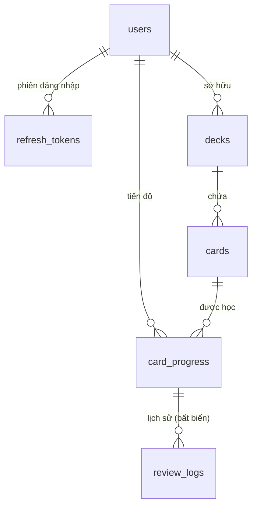

# SpacedVocab — Handbook tiếp nhận dự án

> Tài liệu cho **người hoặc AI agent mới** tiếp nhận dự án. Đọc xong file này bạn sẽ biết: dự án làm gì, stack ra sao, chạy và kết nối Docker / PostgreSQL thế nào, quy tắc nào không được phá, và việc gì đang dở.
>
> **Cập nhật lần cuối:** 24/11/2026 · branch `feat/sm2-review` · đã kiểm chứng trên Windows 11 + Docker Desktop 29.9 + Compose v5.7.

---

## Mục lục
1. [TL;DR cho agent mới](#1-tldr-cho-agent-mới)
2. [Dự án là gì](#2-dự-án-là-gì)
3. [Tech stack](#3-tech-stack)
4. [Kiến trúc và mô hình dữ liệu](#4-kiến-trúc-và-mô-hình-dữ-liệu)
5. [Cấu trúc thư mục](#5-cấu-trúc-thư-mục)
6. [Chuẩn bị máy](#6-chuẩn-bị-máy)
7. [Biến môi trường và `.env`](#7-biến-môi-trường-và-env)
8. [Docker và Docker Compose](#8-docker-và-docker-compose)
9. [Kết nối PostgreSQL](#9-kết-nối-postgresql)
10. [Chạy ứng dụng (3 cách)](#10-chạy-ứng-dụng-3-cách)
11. [Test](#11-test)
12. [API](#12-api)
13. [Quy tắc nghiệp vụ R1–R9 trong code](#13-quy-tắc-nghiệp-vụ-r1r9-trong-code)
14. [Convention code và Git](#14-convention-code-và-git)
15. [Trạng thái hiện tại và việc tiếp theo](#15-trạng-thái-hiện-tại-và-việc-tiếp-theo)
16. [Xử lý sự cố](#16-xử-lý-sự-cố)
17. [Checklist ngày đầu](#17-checklist-ngày-đầu)

---

## 1. TL;DR cho agent mới

**Đọc theo thứ tự:** file này → [`CLAUDE.md`](../CLAUDE.md) (quy tắc bắt buộc) → [`docs/domain/business-spec.md`](domain/business-spec.md) (nghiệp vụ, nguồn sự thật) → [`docs/design/03-information-architecture.md`](design/03-information-architecture.md) (bảng màn hình ↔ API).

**Không bao giờ được:**
- Sửa migration Flyway đã chạy (`V1`–`V4`). Luôn thêm `V{n+1}__mo_ta.sql`.
- Commit `.env`, in giá trị secret ra chat/log, hay hardcode secret trong code.
- `git push` hoặc tạo PR khi chưa hỏi chủ dự án.
- **Viết lời giải `Sm2Algorithm` hoặc `Sm2AlgorithmTest`** — M3 là **chế độ gia sư**: chủ dự án tự code, agent chỉ hỏi gợi mở và gợi ý từng bước. Cũng **đừng chỉ** cho họ đoạn SM-2 có sẵn trong `docs/design/prototype/assets/app.js`.

**Luôn phải:**
- Chạy `git status` trước khi sửa; có thay đổi chưa commit → commit snapshot hoặc tạo branch.
- Đổi nghiệp vụ → sửa `business-spec.md` **trước**, rồi code, rồi tài liệu design.
- Thêm `ErrorCode` → thêm cả vào bảng trong [`06-ux-copy.md`](design/06-ux-copy.md).
- Thêm/đổi endpoint → cập nhật bảng API trong `03-information-architecture.md` **cùng commit**.
- Trả lời chủ dự án bằng **tiếng Việt**, ngắn gọn, gạch đầu dòng.

**Lệnh nhanh (chạy ở thư mục gốc repo):**
```bash
docker compose up -d --build        # DB + API → http://localhost:8090 + web → http://localhost:3000
docker compose ps                   # cả hai phải "healthy"
docker compose logs -f app          # log API
curl http://localhost:8090/actuator/health   # {"status":"UP"}
```

---

## 2. Dự án là gì

**SpacedVocab** là **REST API học từ vựng tiếng Anh bằng flashcard**. Lịch ôn được tính bằng thuật toán lặp lại ngắt quãng **SM-2** (Woźniak, 1987): nhớ càng chắc thì càng lâu mới gặp lại thẻ. Đây là dự án **portfolio** sẽ đưa lên GitHub, nên code cần sạch, có test và có tài liệu.

| Actor | Làm được gì |
|---|---|
| **Guest** | Đăng ký, đăng nhập, xem deck công khai (M4) |
| **Learner** | Quản lý deck/thẻ của mình, ôn tập hằng ngày, (M4) import CSV, subscribe deck công khai, report; (M5) thống kê, streak |
| **Admin** | (M4) Khóa/mở user, quản lý deck OFFICIAL, xử lý report |
| **System** | Chạy SM-2 sau mỗi lần chấm; (M5) job streak/thống kê |

**Quyết định thiết kế cốt lõi:** tách **`Card`** (nội dung dùng chung) khỏi **`CardProgress`** (tiến độ SM-2 riêng của từng người), để nhiều người học chung một deck mà không phải copy thẻ.

**Frontend** ở `web/` (React 19 + Vite), mở tại **<http://localhost:3000>** sau `docker compose up -d --build`. Đã có các màn D2, D3, D7, D8, D9, D10, D11, D13, D14, D22; phong cách "trà sữa vẽ tay" (không gradient) với linh vật robot **Bit** chào bằng tiếng Anh theo giờ. Bộ **thiết kế 22 màn (D1–D22)** và **prototype HTML** trong `docs/design/` vẫn là "hợp đồng" về hành vi; về màu sắc thì `web/src/styles/tokens.css` là bản mới nhất.

---

## 3. Tech stack

| Lớp | Công nghệ | Phiên bản | Ghi chú |
|---|---|---|---|
| Ngôn ngữ | Java | **21** | `record`, pattern matching, `List#getFirst` |
| Framework | Spring Boot | **4.1.3** | Web MVC, Data JPA, Validation, Actuator |
| Bảo mật | Spring Security 7 + OAuth2 Resource Server | theo Boot | JWT **HS256**, stateless, không CSRF |
| ORM | Hibernate | 7 (theo Boot) | `ddl-auto: validate`, `open-in-view: false` |
| Database | **PostgreSQL** | **17** (`postgres:17-alpine`) | Lưu thời gian **UTC** (`TIMESTAMPTZ`) |
| Migration | **Flyway** | theo Boot + `flyway-database-postgresql` | `src/main/resources/db/migration` |
| Build | Maven Wrapper | Maven **3.9.16** | `./mvnw`, `mvnw.cmd` |
| Test | JUnit 5, AssertJ, `MockMvcTester`, **Testcontainers** | theo Boot | Postgres thật, **không dùng H2** |
| Container | Docker, Docker Compose | Compose spec, `name: spacedvocab` | Image multi-stage, chạy user không phải root |
| CI | GitHub Actions | `.github/workflows/ci.yml` | `./mvnw -B verify` + `docker build` |
| HTTP client mẫu | IntelliJ HTTP Client | — | `http/*.http` |
| Thiết kế | HTML/CSS/JS thuần | — | `docs/design/prototype/` |

**Starter trong `pom.xml`:** `webmvc`, `validation`, `actuator`, `security`, `security-oauth2-resource-server`, `data-jpa`, `flyway`; driver `postgresql`. Test: `starter-test`, `webmvc-test`, `security-test`, `spring-boot-testcontainers`, `testcontainers-junit-jupiter`, `testcontainers-postgresql`.

> Spring Boot 4 đã tách nhiều module test (ví dụ `org.springframework.boot.webmvc.test.autoconfigure.AutoConfigureMockMvc`). Khi tra tài liệu, hãy chọn đúng phiên bản 4.x, đừng dùng ví dụ của Boot 2/3.

---

## 4. Kiến trúc và mô hình dữ liệu

### 4.1 Layer và luồng request

```mermaid
flowchart LR
    C[Client] -->|Bearer JWT| F[Security filter chain<br/>JwtDecoder HS256]
    F --> CV[UserJwtAuthenticationConverter<br/>đọc lại User từ DB mỗi request]
    CV --> CT[controller<br/>@AuthenticationPrincipal AuthenticatedUser]
    CT -->|DTO record + @Valid| S[service<br/>@Transactional]
    S --> DA[DeckAccessService<br/>requireVisible 404 / requireEditable 403]
    S --> E[entity<br/>rich domain model]
    S --> R[repository<br/>Spring Data JPA]
    E --> A[algorithm<br/>SpacedRepetitionAlgorithm]
    R --> DB[(PostgreSQL)]
    S -.lỗi.-> EX[AppException → GlobalExceptionHandler<br/>{code, message, field?, errors?}]
```

| Package (`com.spacedvocab.*`) | Vai trò |
|---|---|
| `controller` | REST endpoint, chỉ nhận DTO và gọi service |
| `service` | Nghiệp vụ, transaction. `DeckAccessService` gom mọi kiểm tra quyền deck. `StudyDay` = "hôm nay" theo timezone user |
| `repository` | Spring Data JPA; projection `DeckWithCardCount`, `StateCount` |
| `entity` | JPA entity **không có setter tự do**; đổi trạng thái qua method có tên nghiệp vụ |
| `dto` | Java `record`, tách khỏi entity; validate bằng Bean Validation (message tiếng Việt) |
| `algorithm` | `SpacedRepetitionAlgorithm` (Strategy, hàm thuần) → `Sm2Algorithm`; value object `Quality`, `EasinessFactor`, `SchedulingState` |
| `config` | `ClockConfig` (bean `Clock` UTC), `AdminAccountInitializer`, properties; `config/security` cho JWT, CORS, xử lý lỗi filter |
| `exception` | `AppException` + `ErrorCode`, `GlobalExceptionHandler` (`@RestControllerAdvice`) |

### 4.2 Bảo mật
- **Access token:** JWT HS256, sống **15 phút**, issuer `spacedvocab`, ký bằng `JWT_SECRET`.
- **Refresh token:** chuỗi ngẫu nhiên, sống **14 ngày**. DB **chỉ lưu SHA-256**. Mỗi lần refresh thì **xoay vòng** (cấp token mới, thu hồi token cũ). Dùng lại token cũ → **thu hồi mọi phiên** của user đó.
- `UserJwtAuthenticationConverter` đọc lại user mỗi request, nên **khóa tài khoản có hiệu lực ngay** (403 `ACCOUNT_LOCKED`).
- **Public:** `POST /api/auth/{register,login,refresh,logout}`, `GET /api/public/**`, `/actuator/health/**`, `/actuator/info`. `/api/admin/**` cần role `ADMIN`. Còn lại cần đăng nhập.
- Lỗi 401/403 sinh ra trong filter được `SecurityErrorHandler` chuyển về `GlobalExceptionHandler`, nên mọi lỗi có cùng một định dạng JSON.
- CORS: origin lấy từ `CORS_ALLOWED_ORIGINS` (mặc định `http://localhost:5173` của Vite).

### 4.3 Mô hình dữ liệu (đang có trong DB)



| Bảng | Migration | Điểm cần nhớ |
|---|---|---|
| `app_metadata` | V1 | Bảng baseline M0, không dùng trong nghiệp vụ |
| `users` | V2 | `email` luôn lowercase + unique; `role` LEARNER/ADMIN; `status` ACTIVE/LOCKED; `daily_new_limit` 0–200 (mặc định 20); `timezone` mặc định `Asia/Ho_Chi_Minh` |
| `refresh_tokens` | V2 | `token_hash` (SHA-256 hex) unique, `revoked_at` |
| `decks` | V3 | `visibility` PRIVATE/PUBLIC/OFFICIAL; **xóa mềm** `deleted_at`; unique partial index `(owner_id, lower(name)) WHERE deleted_at IS NULL` |
| `cards` | V3 | Nội dung `word, meaning, ipa, part_of_speech, example, note` (value object `CardContent`); xóa mềm; unique `(deck_id, lower(word)) WHERE deleted_at IS NULL` |
| `card_progress` | V4 | Unique `(user_id, card_id)`; `easiness_factor ≥ 1.3`; `state` NEW/LEARNING/REVIEW; `next_review_at` = 00:00 ngày ôn tiếp theo theo timezone user |
| `review_logs` | V4 | EF/interval/state trước và sau mỗi lần chấm. **Trigger `trg_review_logs_append_only` chặn mọi UPDATE/DELETE** (R8) |
| `flyway_schema_history` | Flyway | Lịch sử migration, **không sửa tay** |

### 4.4 Các mẫu thiết kế đáng chú ý
- **Rich domain model:** `CardProgress.applyReview(quality, algorithm, clock)` là cách **duy nhất** để đổi lịch ôn; method này đồng thời tạo `ReviewLog`.
- **Strategy:** `SpacedRepetitionAlgorithm#next(SchedulingState, Quality)` là hàm thuần (không đọc DB, không đọc đồng hồ), nên dễ test.
- **Value object** tự kiểm tra trong constructor: `Quality` (0..5), `EasinessFactor` (≥ 1.3), `SchedulingState`, `CardContent`.
- **Ownable + DeckAccessService:** deck PRIVATE của người khác → **404** (không lộ sự tồn tại); deck PUBLIC của người khác → xem được, ghi thì **403**.
- **Xóa mềm** deck/card; mọi query đều lọc `deletedAt is null`.
- **`Clock` inject** khắp nơi; "ngày học" tính theo timezone của user (`StudyDay`).
- **Chống race condition:** kiểm tra trước, rồi `saveAndFlush`; bắt `DataIntegrityViolationException` → 409. `CardProgress` được lock `PESSIMISTIC_WRITE` khi chấm.

---

## 5. Cấu trúc thư mục

```
SpacedVocab/
├── CLAUDE.md                  # quy tắc cho AI agent (bắt buộc đọc)
├── README.md                  # giới thiệu (tiếng Anh, cho GitHub)
├── docker-compose.yml         # db + app + web + adminer (profile tools)
├── Dockerfile                 # build multi-stage → JRE 21 alpine
├── .env.example               # mẫu biến môi trường (commit)  |  .env (KHÔNG commit)
├── pom.xml, mvnw, mvnw.cmd, .mvn/
├── .github/workflows/ci.yml
├── http/                      # auth.http, decks.http, reviews.http (IntelliJ HTTP Client)
├── web/                       # frontend React + Vite (Dockerfile → nginx, nginx.conf proxy /api)
├── docs/
│   ├── HANDBOOK.md            # file này
│   ├── domain/business-spec.md        # nghiệp vụ, R1–R9, công thức SM-2
│   └── design/                # 01..06 + prototype/ (22 màn HTML)
└── src/
    ├── main/java/com/spacedvocab/{controller,service,repository,entity,dto,config,exception,algorithm}
    ├── main/resources/application.yml
    ├── main/resources/db/migration/V1..V4__*.sql
    ├── test/java/com/spacedvocab/     # IntegrationTest, TestcontainersConfiguration, controller/*, entity/*, ...
    └── test/resources/application-test.yml   # giá trị giả cho test
```

---

## 6. Chuẩn bị máy

| Công cụ | Bắt buộc? | Ghi chú |
|---|---|---|
| **Docker Desktop** (WSL2 backend) | ✅ | Chạy DB, API, test (Testcontainers). Phải **đang chạy** trước mọi lệnh `docker` |
| **Git** (kèm Git Bash) | ✅ | `.gitattributes` ép **LF** (trừ `*.cmd`/`*.bat`) |
| IntelliJ IDEA | Nên có | Chạy/debug app, HTTP Client, tab Database |
| JDK 21 (Temurin) | Tùy chọn | Máy chủ dự án **không có `java`/`mvn` trong PATH**, nên build/test qua Docker hoặc qua JDK của IntelliJ |
| Python 3 | Tùy chọn | Để mở prototype (`python -m http.server`) |
| `psql` trên máy | Không cần | Dùng `psql` bên trong container (xem §9) |

**Lưu ý riêng cho Windows:**
- **Docker Desktop tắt** sẽ báo `failed to connect to the docker API at npipe:////./pipe/dockerDesktopLinuxEngine`. Mở Docker Desktop, chờ engine sẵn sàng (`docker info` chạy được) rồi làm lại.
- **Git Bash tự đổi đường dẫn** (`/w` thành `C:/Program Files/Git/w`). Khi chạy `docker run -v ...` trong Git Bash, thêm `MSYS_NO_PATHCONV=1` ở đầu lệnh. PowerShell không bị lỗi này.
- **curl trong Git Bash không gửi UTF-8 đúng** với chữ có dấu, nên API trả 400 "JSON không đúng định dạng". Ghi body ra file UTF-8 rồi gửi bằng `--data-binary @body.json`, hoặc dùng IntelliJ HTTP Client / PowerShell.
- **Cổng 8080 đã có dự án khác dùng**, vì vậy API publish ra **8090**.

---

## 7. Biến môi trường và `.env`

`docker compose` tự đọc file `.env` ở thư mục gốc. Lần đầu tạo file:

```bash
cp .env.example .env
# sửa DB_PASSWORD, và JWT_SECRET (tạo bằng: openssl rand -base64 48)
```

| Biến | Bắt buộc | Mặc định | Dùng ở đâu | Ý nghĩa |
|---|---|---|---|---|
| `DB_NAME` | | `spacedvocab` | db, app | Tên database |
| `DB_USERNAME` | | `spacedvocab` | db, app | User Postgres |
| `DB_PASSWORD` | ✅ | — | db, app | Compose dừng với lỗi `Set DB_PASSWORD in .env` nếu thiếu |
| `DB_PORT` | | `5432` | db | Cổng **trên máy host** để kết nối DB |
| `APP_PORT` | | `8090` | app | Cổng host → cổng 8080 trong container |
| `WEB_PORT` | | `3000` | web | Cổng mở giao diện web trên máy host |
| `ADMINER_PORT` | | `8081` | adminer | Cổng UI quản lý DB |
| `JWT_SECRET` | ✅ | — | app | Khóa ký HS256, **≥ 32 ký tự**; thiếu thì app không khởi động |
| `CORS_ALLOWED_ORIGINS` | | `http://localhost:5173` | app | Danh sách origin, cách nhau bằng dấu phẩy |
| `ADMIN_EMAIL`, `ADMIN_PASSWORD` | | rỗng | app | Tạo admin đầu tiên khi khởi động nếu email chưa tồn tại (mật khẩu ≥ 8 ký tự). **Không seed admin bằng migration** |
| `DB_URL` | | `jdbc:postgresql://localhost:5432/spacedvocab` | app (ngoài Docker) | Compose tự đặt `jdbc:postgresql://db:5432/...` cho container app |
| `SERVER_PORT` | | `8080` | app (ngoài Docker) | Cổng Tomcat khi chạy từ IntelliJ |

**Quy tắc:**
- `.env` **đã có trong `.gitignore` và `.dockerignore`**, nên không bị commit và không bị copy vào image.
- Thêm biến mới thì cập nhật `.env.example` (chỉ để giá trị mẫu), `application.yml` (`${VAR:default}`) và bảng ở trên.
- Test **không đọc `.env`**: giá trị giả nằm trong `src/test/resources/application-test.yml`.
- Agent: cần xem `.env` có những khóa nào thì dùng `sed 's/=.*/=<hidden>/' .env`, **không `cat .env`**.

---

## 8. Docker và Docker Compose

### 8.1 Các service

| Service | Image | Cổng host → container | Healthcheck | Ghi chú |
|---|---|---|---|---|
| `db` | `postgres:17-alpine` | `${DB_PORT:-5432}` → 5432 | `pg_isready` mỗi 5s | Volume **`spacedvocab_db-data`**, `TZ=UTC` |
| `app` | build từ `Dockerfile` | `${APP_PORT:-8090}` → 8080 | `/actuator/health/readiness` = UP | Chỉ khởi động khi `db` healthy |
| `web` | build từ `web/Dockerfile` (nginx) | `${WEB_PORT:-3000}` → 80 | trang chủ trả về `index.html` | Chỉ khởi động khi `app` healthy; proxy `/api` → `app:8080` |
| `adminer` | `adminer:latest` | `${ADMINER_PORT:-8081}` → 8080 | — | Chỉ chạy với `--profile tools` |

Tên project Compose là `spacedvocab`, nên container tên `spacedvocab-db-1`, `spacedvocab-app-1`, `spacedvocab-web-1`, `spacedvocab-adminer-1`; network `spacedvocab_default`. Trong network này, các service gọi nhau bằng **tên service** (`db`, `app`).

### 8.2 Lệnh vòng đời

```bash
docker compose up -d --build          # build lại image app + chạy db & app (dùng sau mỗi lần đổi code)
docker compose up -d db               # chỉ chạy DB (khi chạy app từ IntelliJ)
docker compose --profile tools up -d  # thêm Adminer
docker compose ps                     # trạng thái + cổng; chờ cả hai "healthy"
docker compose logs -f app            # theo dõi log API (Flyway, lỗi khởi động...)
docker compose logs db --tail 50
docker compose restart app
docker compose stop                   # dừng, giữ container
docker compose down                   # xóa container, GIỮ dữ liệu (volume)
docker compose down -v                # ⚠ XÓA LUÔN DỮ LIỆU DB (volume db-data) — hỏi chủ dự án trước
```

**Dấu hiệu khởi động thành công** trong `docker compose logs app`:
```
FlywayExecutor  : Database: jdbc:postgresql://db:5432/spacedvocab (PostgreSQL 17.x)
DbValidate      : Successfully validated 4 migrations
DbMigrate       : ... now at version v4          (hoặc "Schema is up to date")
TomcatWebServer : Tomcat started on port 8080
```

### 8.3 Dockerfile (multi-stage)
1. **Stage `build`** (`maven:3.9-eclipse-temurin-21`): resolve dependency trước để cache layer, `mvn package -DskipTests` (test chạy ở CI hoặc `mvn verify`), rồi tách jar thành các layer (`-Djarmode=tools extract --layers`).
2. **Stage runtime** (`eclipse-temurin:21-jre-alpine`): chạy bằng user `spring` (không phải root), copy layer theo thứ tự ít đổi → hay đổi, `-XX:MaxRAMPercentage=75`.

### 8.4 Volume

| Volume | Chứa gì | Xóa thì sao |
|---|---|---|
| `spacedvocab_db-data` | Dữ liệu PostgreSQL | Mất hết user/deck/thẻ; lần chạy sau Flyway tạo lại schema từ V1 |
| `spacedvocab-m2` | Cache Maven cho lệnh test trong container | Lần test sau tải lại dependency (chậm hơn) |

---

## 9. Kết nối PostgreSQL

### 9.1 Thông số

| Kết nối từ | Host | Cổng | Database / User | Mật khẩu |
|---|---|---|---|---|
| **Máy host** (IntelliJ, DBeaver, app chạy trong IntelliJ) | `localhost` | `DB_PORT` (mặc định **5432**) | `DB_NAME` / `DB_USERNAME` (mặc định `spacedvocab` / `spacedvocab`) | `DB_PASSWORD` trong `.env` |
| **Container khác cùng compose** (`app`, `adminer`) | **`db`** | **5432** (cổng trong network, không phải `DB_PORT`) | như trên | như trên |
| **Container chạy riêng** (`docker run ...`) | `host.docker.internal` | `DB_PORT` | như trên | như trên |

JDBC URL từ máy host: `jdbc:postgresql://localhost:5432/spacedvocab`

### 9.2 Cách 1 — `psql` trong container (nhanh nhất, không cần mật khẩu)

```bash
docker compose exec db sh -c 'psql -U "$POSTGRES_USER" -d "$POSTGRES_DB"'
```
Lệnh dùng biến môi trường có sẵn trong container, nên không phải gõ user/mật khẩu. Vài lệnh hữu ích trong `psql`:
```sql
\dt                                   -- liệt kê bảng
\d card_progress                      -- cấu trúc bảng
select version, description, success from flyway_schema_history order by installed_rank;
select id, email, role, status, timezone from users order by id desc limit 10;
select state, count(*) from card_progress group by state;
show timezone;                        -- phải là UTC
\q
```
Chạy một câu lệnh rồi thoát (dùng trong script / agent):
```bash
docker compose exec -T db sh -c 'psql -U "$POSTGRES_USER" -d "$POSTGRES_DB" -c "\dt"'
```

### 9.3 Cách 2 — Adminer (giao diện web)

```bash
docker compose --profile tools up -d
```
Mở <http://localhost:8081> và điền:

| Ô | Giá trị |
|---|---|
| System | **PostgreSQL** |
| Server | **`db`** ← không phải `localhost`, vì Adminer chạy trong network Docker |
| Username | giá trị `DB_USERNAME` |
| Password | giá trị `DB_PASSWORD` |
| Database | giá trị `DB_NAME` |

### 9.4 Cách 3 — IntelliJ Database / DBeaver / pgAdmin
- *IntelliJ:* Database → **+** → Data Source → PostgreSQL. Host `localhost`, Port `5432` (hoặc `DB_PORT`), Database `spacedvocab`, User/Password lấy từ `.env`. Bấm **Test Connection** (lần đầu IntelliJ sẽ tải driver).
- *DBeaver/pgAdmin:* cùng thông số như trên.
- **Không lưu mật khẩu vào file project được commit.**

### 9.5 Cách 4 — client `psql` chạy trong container riêng, qua cổng publish

Dùng cách này để kiểm tra đường kết nối "từ bên ngoài" (giống IntelliJ) mà không cần cài `psql`:
```bash
# Git Bash: thêm MSYS_NO_PATHCONV=1 ở đầu lệnh
docker run --rm --env-file .env postgres:17-alpine sh -c \
  'PGPASSWORD="$DB_PASSWORD" psql -h host.docker.internal -p "${DB_PORT:-5432}" -U "$DB_USERNAME" -d "$DB_NAME" -c "select current_database(), current_user"'
```

### 9.6 Ba loại DB, đừng nhầm

| DB | Dùng khi | Dữ liệu |
|---|---|---|
| Compose `db` (volume `db-data`) | Chạy app, thử API bằng tay | Giữ lại giữa các lần chạy |
| **Testcontainers** (`TestcontainersConfiguration`, `postgres:17-alpine`) | `mvn verify` | Container tạm, mỗi lần chạy test tạo mới rồi xóa. **Không đụng DB compose** |
| Postgres ở CI | GitHub Actions | Testcontainers dùng Docker của runner |

### 9.7 Flyway — quy tắc
- Schema **chỉ** do Flyway tạo. Hibernate chỉ `validate`: entity lệch schema thì app **không khởi động**.
- Thêm bảng/cột: tạo `src/main/resources/db/migration/V5__mo_ta_ngan.sql` (hai dấu gạch dưới). Khởi động lại app thì Flyway tự chạy.
- **Không sửa file `V1`–`V4`.** Sửa file đã chạy → Flyway báo `checksum mismatch` → app không khởi động.
- Thời gian dùng `TIMESTAMPTZ` (UTC). Unique theo tên dùng partial index `lower(...) WHERE deleted_at IS NULL`.

---

## 10. Chạy ứng dụng (3 cách)

### Cách A — Tất cả trong Docker (khuyên dùng)
```bash
docker compose up -d --build
curl http://localhost:8090/actuator/health          # {"groups":["liveness","readiness"],"status":"UP"}
```

### Cách B — DB trong Docker, app trong IntelliJ (để debug)
1. `docker compose up -d db`
2. Run Configuration của `SpacedVocabApplication` → **Environment variables**: `DB_PASSWORD=...;JWT_SECRET=...` (lấy từ `.env`). Thêm `DB_URL=jdbc:postgresql://localhost:<DB_PORT>/spacedvocab` nếu `DB_PORT` khác 5432. Có thể thêm `SERVER_PORT=8090`.
3. Mặc định app chạy ở **8080**. Nếu cổng 8080 đang bị dự án khác chiếm, đặt `SERVER_PORT=8090` và nhớ `docker compose stop app` trước để tránh trùng cổng.

### Cách C — jar
Cần JDK 21: `./mvnw -DskipTests package` rồi `java -jar target/spacedvocab-api-0.0.1-SNAPSHOT.jar` (đặt các biến môi trường như cách B).

### Tạo tài khoản để thử
- **Learner:** `POST /api/auth/register` (xem `http/auth.http`).
- **Admin:** đặt `ADMIN_EMAIL` / `ADMIN_PASSWORD` trong `.env` rồi `docker compose up -d` lại; log sẽ ghi `Created admin account ...`.

### Prototype UI
```bash
python -m http.server 5500 --directory docs/design/prototype   # → http://localhost:5500
```

---

## 11. Test

### 11.1 Chạy toàn bộ

Máy không có Maven/JDK trong PATH, nên chạy test trong container Maven (container này cần Docker socket để Testcontainers tạo Postgres):

```bash
# Git Bash (thay đường dẫn repo nếu khác)
MSYS_NO_PATHCONV=1 docker run --rm \
  -v "D:/03_Projects/SpacedVocab:/w" -v spacedvocab-m2:/root/.m2 \
  -v //var/run/docker.sock:/var/run/docker.sock \
  -e TESTCONTAINERS_HOST_OVERRIDE=host.docker.internal \
  -w /w maven:3.9-eclipse-temurin-21 mvn -B verify
```
- Có JDK 21 thì chạy `./mvnw verify` trực tiếp, hoặc bấm Run trong IntelliJ.
- Chỉ một class: thêm `-Dtest=ReviewControllerTests` (với `mvn test`). Unit test không cần DB: `mvn -B -q test -Dtest=ValueObjectTest`.
- Kết quả chi tiết nằm ở `target/surefire-reports/`.
- **Hiện tại: 115/115 test pass** (lần chạy 23/11/2026, branch `feat/sm2-review`).

### 11.2 Convention test

| Loại | Cách viết |
|---|---|
| Integration | Gắn meta-annotation **`@IntegrationTest`** (SpringBootTest + MockMvc + profile `test` + Testcontainers), kế thừa `controller/ApiTestSupport`, gọi API bằng `MockMvcTester` |
| Dữ liệu | Mỗi test tự `registerNew()` với **email ngẫu nhiên**, nên không cần dọn DB |
| Helper | `postJson`, `putJson`, `getWithToken`, `deleteWithToken`, `createDeck`, `createCard`, `register`, `login`, `refresh` |
| Unit entity | `ReflectionTestUtils.setField(entity, "id", 1L)` để gán id |
| SM-2 | `@ParameterizedTest` với bộ (trạng thái, quality) → kết quả theo spec §5 — **do chủ dự án tự viết** |
| Ôn tập | `ReviewControllerTests` dùng **algorithm giả** (`@TestConfiguration` + `@Primary`), nên không phụ thuộc SM-2 |
| Thời gian | **Không thay bean `Clock`** trong integration test (JWT dùng chung `Clock`; đổi giờ sẽ làm token hết hạn). Muốn thẻ "đến hạn" thì sửa `card_progress.next_review_at` bằng `JdbcTemplate` |
| Ràng buộc | Mỗi rule R1–R9 nên có ít nhất 1 test; tên test có hậu tố `_R6`, `_R7`... |

---

## 12. API

Base URL: `http://localhost:8090`. Request có body dùng `Content-Type: application/json`. Endpoint cần đăng nhập thì gửi header `Authorization: Bearer <accessToken>`.

| Endpoint | Auth | Mô tả | Màn |
|---|---|---|---|
| `POST /api/auth/register` `{email, password, displayName?, timezone?}` | – | Tạo learner + đăng nhập → 201 `{accessToken, tokenType, expiresIn, refreshToken, user}` | D2 |
| `POST /api/auth/login` `{email, password}` | – | Lấy cặp token | D3 |
| `POST /api/auth/refresh` `{refreshToken}` | – | Xoay vòng refresh token | — |
| `POST /api/auth/logout` `{refreshToken}` | – | Thu hồi refresh token → 204 | D16 |
| `GET/PUT /api/me` | Bearer | Xem / đổi `displayName` | D16 |
| `PUT /api/me/settings` `{dailyNewLimit, timezone}` | Bearer | Cài đặt học, đồng thời hoàn tất onboarding | D6, D16 |
| `PUT /api/me/password` `{currentPassword, newPassword}` | Bearer | Đổi mật khẩu, đăng xuất các phiên khác → 204 | D16 |
| `GET /api/decks?scope=owned` | Bearer | Deck của mình kèm `cardCount`, `editable` | D8 |
| `POST /api/decks` · `GET/PUT/DELETE /api/decks/{id}` | Bearer | CRUD deck (PRIVATE/PUBLIC). `GET` chi tiết có `progress {newCount, learningCount, reviewCount}` | D9, D10 |
| `GET /api/decks/{id}/cards?q=&page=0&size=20` | Bearer | Tìm thẻ, phân trang (`page` tính từ 0, `size` ≤ 100) → `PageResponse` | D10 |
| `POST /api/decks/{id}/cards` · `GET/PUT/DELETE .../cards/{cardId}` | Bearer | CRUD thẻ | D11 |
| `GET /api/reviews/due?deckId=&limit=50` | Bearer | Thẻ đến hạn + thẻ mới trong hạn mức ngày; mỗi thẻ có `previewIntervals`. `limit=0` = chỉ lấy số đếm | D7, D13 |
| `POST /api/reviews` `{cardId, quality: 0..5}` | Bearer | Chấm điểm → lịch mới | D13 |
| `GET /actuator/health` | – | Health (liveness/readiness) | — |

> ⚠ Cho tới khi `Sm2Algorithm` được cài đặt, `GET /api/reviews/due` (khi có thẻ) và `POST /api/reviews` trả **500** (`UnsupportedOperationException`). Đây là trạng thái dự kiến, không phải bug.

**Định dạng lỗi** (mọi lỗi đều giống nhau):
```json
{ "code": "VALIDATION_FAILED", "message": "Dữ liệu chưa hợp lệ...", "field": "email",
  "errors": [ { "field": "email", "message": "Email chưa đúng định dạng." } ] }
```
`errors` chỉ có khi `VALIDATION_FAILED`.

| HTTP | `code` |
|---|---|
| 400 | `VALIDATION_FAILED` |
| 401 | `UNAUTHORIZED`, `BAD_CREDENTIALS`, `TOKEN_EXPIRED` |
| 403 | `ACCOUNT_LOCKED`, `FORBIDDEN` |
| 404 / 405 | `NOT_FOUND` / `METHOD_NOT_ALLOWED` |
| 409 | `EMAIL_TAKEN`, `DECK_NAME_TAKEN`, `CARD_WORD_TAKEN`, `REVIEW_CONFLICT` |
| 422 | `WRONG_CURRENT_PASSWORD`, `CARD_NOT_IN_LIBRARY`, `DAILY_NEW_LIMIT_REACHED` |
| 500 | `INTERNAL_ERROR` |

`06-ux-copy.md` còn liệt kê `CANNOT_SUBSCRIBE_OWN_DECK`, `DECK_NOT_PUBLIC`, `CANNOT_LOCK_SELF` cho M4; ba mã này **chưa có trong enum**.

**Thử API:** mở `http/auth.http` → chạy *Register* hoặc *Login* (lưu `{{accessToken}}`) → `http/decks.http` → `http/reviews.http`.

---

## 13. Quy tắc nghiệp vụ R1–R9 trong code

| Mã | Quy tắc (rút gọn) | Thực thi ở đâu | Trạng thái |
|---|---|---|---|
| R1 | Email unique (không phân biệt hoa thường), mật khẩu 8–72 ký tự, LOCKED bị chặn ngay, đổi mật khẩu → đăng xuất phiên khác | `User.normalizeEmail`, constraint DB, `UserJwtAuthenticationConverter`, `AuthService` | ✅ M1 |
| R2 | Tên deck unique theo chủ, `word` unique theo deck (không phân biệt hoa thường, bỏ qua bản ghi đã xóa) | Partial unique index V3, `DeckService` / `CardService` | ✅ M2 |
| R3 | Chỉ chủ sửa deck/card; OFFICIAL chỉ Admin | `Deck#isEditableBy`, `DeckAccessService.requireEditable`, chặn OFFICIAL ở `/api/decks` | ✅ M2 (phần admin ở M4) |
| R4 | Chỉ subscribe deck PUBLIC/OFFICIAL, không phải của mình | — | ⏳ M4 |
| R5 | `quality` 0..5, EF ≥ 1.3, interval ≥ 1 | `Quality`, `EasinessFactor`, `CardProgress.applyReview`, check constraint V4, `@Min/@Max` | ✅ M3 |
| R6 | Chỉ chấm thẻ trong thư viện (deck sở hữu hoặc đã subscribe) | `DeckAccessService#isInLibrary` + các query library | ✅ phần "sở hữu"; M4 thêm subscribe |
| R7 | Số thẻ mới/ngày ≤ `dailyNewLimit`, "ngày" theo timezone user | `ReviewService` (`remainingNewCards`, `startLearning`), `StudyDay` | ✅ M3 |
| R8 | Xóa deck/card luôn là xóa mềm; không bao giờ xóa `ReviewLog` | `deletedAt`, `@Immutable ReviewLog`, trigger DB, repository không có hàm delete | ✅ |
| R9 | Streak +1 nếu có ≥ 1 lượt ôn trong ngày | — (index `review_logs(user_id, reviewed_at)` đã có sẵn) | ⏳ M5 |

---

## 14. Convention code và Git

**Code**
- Package theo layer. **Constructor injection** (không `@Autowired` field). Log bằng **SLF4J**.
- DTO là `record`, không trả entity ra API. Phân trang trả `PageResponse` (không trả `Page` của Spring).
- Thông báo validate và thông báo lỗi viết **tiếng Việt**; comment/Javadoc trong code viết **tiếng Anh**.
- Entity không có setter tự do. Đổi trạng thái qua method nghiệp vụ (`edit`, `delete`, `applyReview`, `lock`...).
- Method public cho logic quyền đặt ở service riêng (`DeckAccessService`), tránh gọi method package-private qua proxy `@Transactional` (có thể gây NPE).

**Git**
- Mỗi milestone/tính năng một branch: `feat/...`, `docs/...`, `chore/...`.
- **Conventional Commits** viết tiếng Việt: `feat:`, `fix:`, `test:`, `docs:`, `refactor:`, `chore:`. Thường tách 3–4 commit mỗi milestone: entity/migration → API → test → docs.
- Commit do agent tạo kết thúc bằng dòng `Co-Authored-By: ...` theo hướng dẫn của công cụ đang dùng.
- **Chỉ commit local. Hỏi trước khi push / tạo PR / merge.**

**Branch hiện có** (chưa branch nào được merge vào `main`; mỗi branch tách từ branch trước):
```
main ─ chore/project-setup (M0) ─ docs/ux-ui-design ─ feat/auth-jwt (M1) ─ feat/deck-card-crud (M2) ─ feat/sm2-review (M3, đang làm)
```
Lưu ý: commit `55e7622` (M1) không build được nếu checkout riêng lẻ. Các đầu branch đều build được.

---

## 15. Trạng thái hiện tại và việc tiếp theo

| Milestone | Nội dung | Trạng thái |
|---|---|---|
| M0 | Maven, Docker, Flyway, CI | ✅ |
| Design | UX/UI D1–D22 + prototype | ✅ |
| M1 | User, JWT, phân quyền | ✅ |
| M2 | CRUD deck & card, quyền sở hữu | ✅ |
| **M3** | SM-2, thẻ đến hạn, chấm điểm, ReviewLog | 🟡 **Xong mọi thứ trừ `Sm2Algorithm`** |
| M4 | Deck public/official, subscribe, import CSV, admin, report | ⏳ |
| M5 | Thống kê, streak, Swagger | ⏳ |

**M3 còn lại (chế độ gia sư):**
- `src/main/java/com/spacedvocab/algorithm/Sm2Algorithm.java` hiện là skeleton ném `UnsupportedOperationException`.
- `src/test/java/com/spacedvocab/algorithm/Sm2AlgorithmTest.java` chưa có.
- Chủ dự án tự code cả hai theo `business-spec.md` §5. Agent hỏi gợi mở từng bước, ví dụ: "Thẻ mới chấm 4 thì repetitions / interval / EF bằng bao nhiêu?". **Không đưa lời giải** trừ khi được yêu cầu rõ ràng.
- Khi SM-2 xong: chạy `mvn verify`, thử API thật bằng `http/reviews.http`, đánh dấu M3 ✅ trong `CLAUDE.md`, `README.md`, `03-information-architecture.md`.

**Ghi chú cho M4 (đã chuẩn bị sẵn):**
- "Thư viện" hiện chỉ gồm deck sở hữu. Phải thêm deck đã subscribe ở **`DeckAccessService#isInLibrary`** và các query `findDue`, `countDue`, `findNextReviewAt` (`CardProgressRepository`), `findNewForLearner`, `countNewForLearner` (`CardRepository`).
- `GET /api/decks?scope=subscribed` hiện trả 400. Admin tạo deck OFFICIAL qua `/api/admin/decks`.
- Thêm các `ErrorCode` M4 vào enum (đã có sẵn trong `06-ux-copy.md`).

---

## 16. Xử lý sự cố

| Triệu chứng | Nguyên nhân | Cách sửa |
|---|---|---|
| `failed to connect to the docker API at npipe:...dockerDesktopLinuxEngine` | Docker Desktop chưa chạy | Mở Docker Desktop, chờ `docker info` chạy được |
| `Set DB_PASSWORD in .env` / `Set JWT_SECRET in .env` | Chưa có `.env` hoặc thiếu biến | `cp .env.example .env` rồi điền giá trị |
| App container restart liên tục, log báo lỗi JWT secret | `JWT_SECRET` ngắn hơn 32 ký tự | Tạo khóa mới bằng `openssl rand -base64 48` |
| `password authentication failed for user "spacedvocab"` sau khi đổi `DB_PASSWORD` | **Postgres chỉ đọc `POSTGRES_PASSWORD` ở lần khởi tạo volume đầu tiên** | Đặt lại mật khẩu cũ trong `.env`, **hoặc** vào `psql` trong container (§9.2, không cần mật khẩu) rồi chạy `ALTER USER spacedvocab PASSWORD '<mật khẩu mới>';`, **hoặc** (mất dữ liệu, hỏi trước) `docker compose down -v` |
| `Bind for 0.0.0.0:5432 failed: port is already allocated` | Máy đã có Postgres khác ở cổng 5432 | Đặt `DB_PORT=5433` trong `.env`, kết nối từ host bằng `localhost:5433`, và đặt `DB_URL` tương ứng khi chạy app từ IntelliJ |
| `netstat` thấy cả `com.docker.backend` và `wslrelay` cùng nghe cổng 5432 | Bình thường với Docker Desktop dùng WSL2 (relay cho `localhost`) | Không cần làm gì, cả hai cùng trỏ tới container `db` |
| `Bind ... :8090 failed` | Cổng 8090 bị chiếm | Đổi `APP_PORT` |
| `Validate failed: Migrations have failed validation` / `checksum mismatch` | Có người sửa migration đã chạy | Hoàn tác file đó về bản gốc; thay đổi mới viết thành `V{n+1}` |
| `Schema-validation: missing column/table` | Entity lệch schema (`ddl-auto: validate`) | Thêm migration mới khớp entity |
| Test lỗi `Could not find a valid Docker environment` | Container Maven không thấy Docker | Thêm `-v //var/run/docker.sock:/var/run/docker.sock -e TESTCONTAINERS_HOST_OVERRIDE=host.docker.internal`, bật Docker Desktop |
| `docker run -v /w` lỗi đường dẫn trong Git Bash | Git Bash tự đổi đường dẫn | Thêm `MSYS_NO_PATHCONV=1` ở đầu lệnh |
| API trả 400 "JSON không đúng định dạng" với chữ có dấu khi dùng curl | Git Bash không gửi UTF-8 | Dùng `--data-binary @file.json` (file UTF-8) hoặc IntelliJ HTTP Client |
| `401 TOKEN_EXPIRED` | Access token đã quá 15 phút | Gọi `POST /api/auth/refresh` |
| `500` ở `/api/reviews...` | `Sm2Algorithm` chưa được cài đặt | Dự kiến, xem §15 |
| Adminer báo không kết nối được `localhost` | Adminer chạy trong network Docker | Server điền **`db`** |
| Code mới không có hiệu lực khi chạy Docker | Image cũ | `docker compose up -d --build` |

---

## 17. Checklist ngày đầu

- [ ] Đọc §1, `CLAUDE.md`, `business-spec.md`, bảng API trong `03-information-architecture.md`.
- [ ] `git status` sạch, đang ở branch đúng (`git branch -vv`).
- [ ] Docker Desktop đang chạy (`docker info` không lỗi).
- [ ] Có `.env` (`sed 's/=.*/=<hidden>/' .env` thấy đủ các khóa như `.env.example`).
- [ ] `docker compose up -d --build` → `docker compose ps` thấy `db` và `app` **healthy**.
- [ ] `curl http://localhost:8090/actuator/health` trả `UP`.
- [ ] `docker compose exec -T db sh -c 'psql -U "$POSTGRES_USER" -d "$POSTGRES_DB" -c "\dt"'` thấy 8 bảng, Flyway ở V4.
- [ ] Chạy `mvn verify` trong container (§11) → toàn bộ test pass.
- [ ] Thử `http/auth.http` → `http/decks.http`.
- [ ] Hỏi chủ dự án đang ở bước nào của `Sm2Algorithm` trước khi đụng vào M3.
