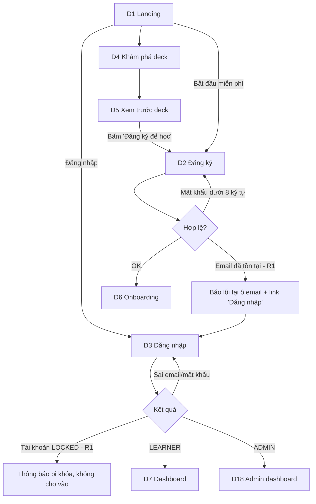
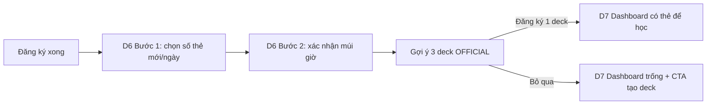
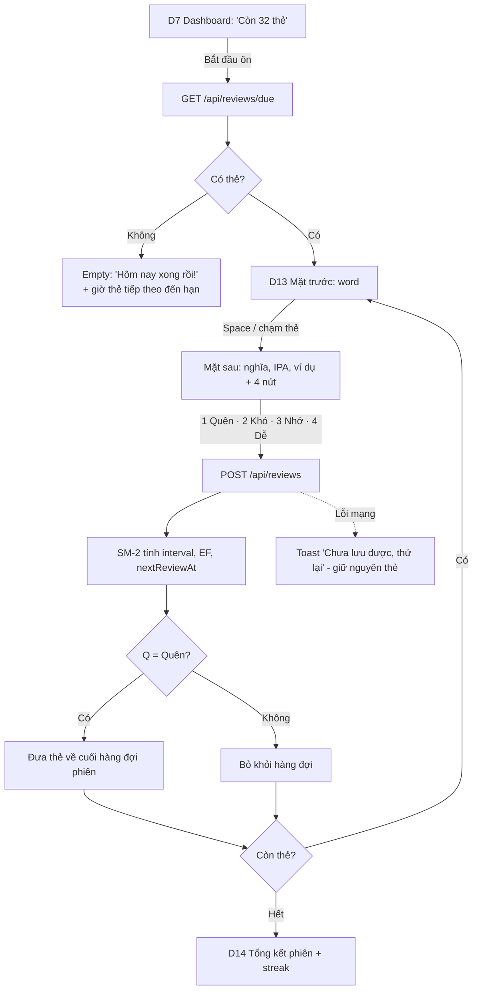
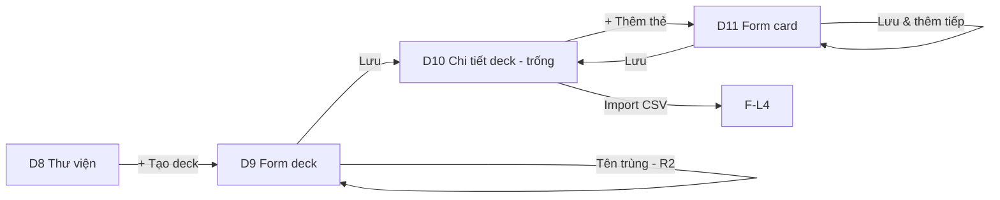
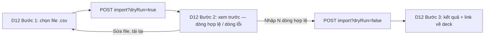
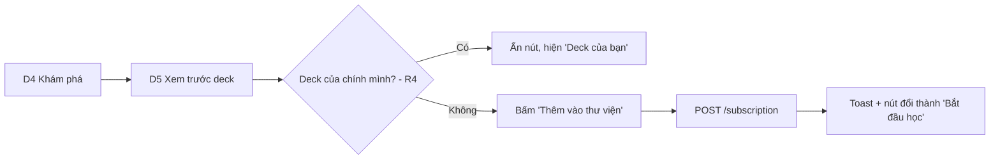
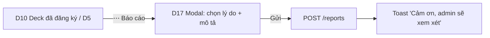
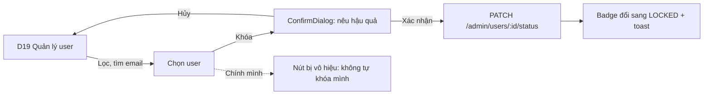
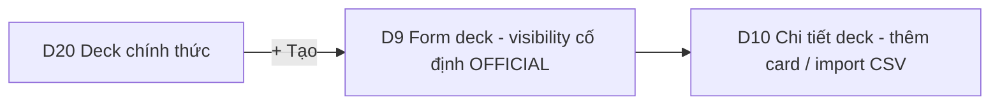
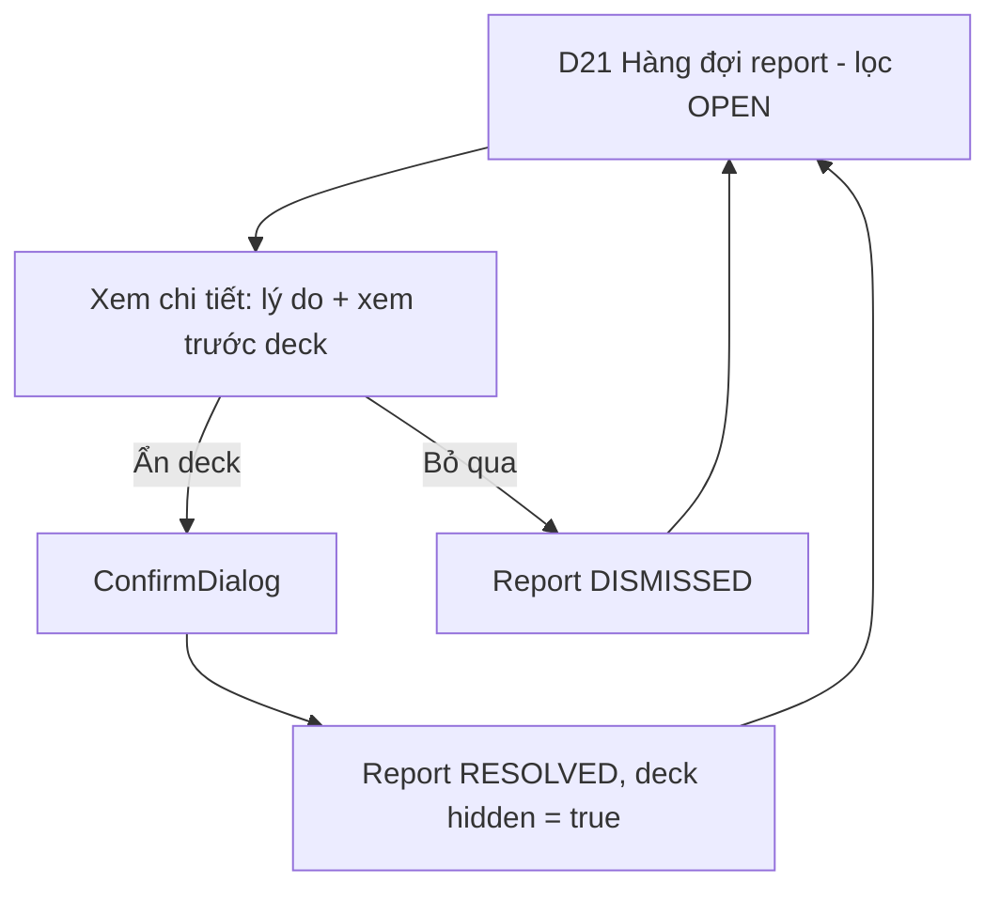

# 02 · Luồng người dùng (User Flows)

> Sơ đồ viết bằng Mermaid — GitHub tự render. Mã màn hình (D1, D7…) khớp với [05-screen-specs.md](05-screen-specs.md).

## Guest

### F-G1 · Khám phá → đăng ký / đăng nhập

## Learner

### F-L1 · Onboarding lần đầu

### F-L2 · Phiên ôn tập hằng ngày (luồng quan trọng nhất)

### F-L3 · Tạo deck và thêm card

### F-L4 · Import CSV

### F-L5 · Đăng ký (subscribe) deck công khai

### F-L6 · Report deck

## Admin

### F-A1 · Khóa / mở khóa user

### F-A2 · Tạo deck chính thức

### F-A3 · Xử lý report

## System (không có màn hình riêng)
- **UC-S1 SM-2**: kết quả thể hiện ở D13 (khoảng thời gian trên mỗi nút), D10 (trạng thái thẻ).
- **UC-S2 Job hằng đêm**: kết quả thể hiện ở D7 (streak), D15 (heatmap, thống kê).
