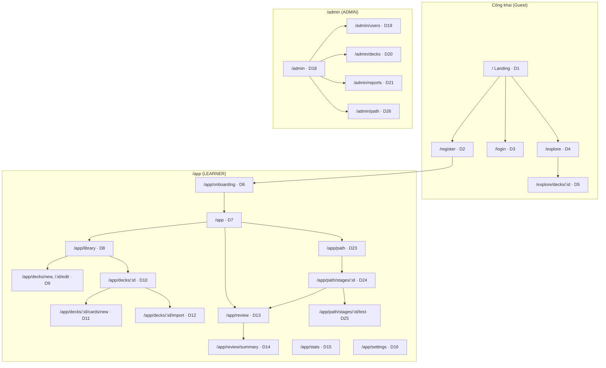

# 03 · Kiến trúc thông tin

## Sitemap

## Điều hướng

| Shell | Mobile (< 768px) | Desktop (≥ 1024px) |
|---|---|---|
| **Guest** | Header: logo + "Đăng nhập" | Header: logo, Khám phá, Đăng nhập, Đăng ký |
| **Learner** | **Bottom nav** 5 mục: Trang chủ · Thư viện · **Ôn tập** (nút giữa, có badge số thẻ) · Thống kê · Tôi | **Sidebar** trái với cùng 5 mục + Khám phá |
| **Admin** | Header + menu dạng drawer | Sidebar: Tổng quan · Người dùng · Deck chính thức · Report (badge số OPEN) |

Phiên ôn tập (D13) **ẩn mọi thanh điều hướng** để tập trung, chỉ có nút ✕ thoát.

## Danh sách route (React Router)

| Route | Màn | Role | Ghi chú |
|---|---|---|---|
| `/` | D1 Landing | Tất cả | Đã đăng nhập → chuyển `/app` |
| `/register`, `/login` | D2, D3 | Guest | Đã đăng nhập → chuyển `/app` |
| `/explore` | D4 | Tất cả | Query `?q=&sort=` |
| `/explore/decks/:deckId` | D5 | Tất cả | Nút thay đổi theo role |
| `/app/onboarding` | D6 | LEARNER | Chỉ hiện lần đầu |
| `/app` | D7 Dashboard | LEARNER | |
| `/app/library` | D8 | LEARNER | Tab `?tab=owned|subscribed` |
| `/app/decks/new`, `/app/decks/:id/edit` | D9 | LEARNER (chủ) | |
| `/app/decks/:id` | D10 | LEARNER (chủ hoặc subscriber) | Subscriber: chỉ đọc |
| `/app/decks/:id/cards/new`, `.../cards/:cardId/edit` | D11 | LEARNER (chủ) | |
| `/app/decks/:id/import` | D12 | LEARNER (chủ) | |
| `/app/review` | D13 | LEARNER | `?deckId=` để ôn 1 deck |
| `/app/review/summary` | D14 | LEARNER | |
| `/app/stats` | D15 | LEARNER | |
| `/app/settings` | D16 | LEARNER, ADMIN | |
| `/app/path` | D23 | LEARNER | Lối vào từ thẻ "Lộ trình" trên D7 |
| `/app/path/stages/:stageId` | D24 | LEARNER | Chặng khóa vẫn xem được danh sách bài, không bắt đầu được |
| `/app/path/stages/:stageId/test` | D25 | LEARNER | Ẩn mọi điều hướng như D13 |
| `/admin` | D18 | ADMIN | |
| `/admin/users` | D19 | ADMIN | `?q=&status=` |
| `/admin/decks` | D20 | ADMIN | Tạo/sửa dùng lại D9–D12 với prefix `/admin` |
| `/admin/reports` | D21 | ADMIN | `?status=OPEN` |
| `/admin/path` | D26 | ADMIN | |
| `/403`, `*` | D22 | Tất cả | |

## Ma trận quyền (role × màn hình × hành động)

Ký hiệu: ✅ được · 👁 chỉ xem · ❌ không · — không áp dụng

| Màn / tài nguyên | Guest | Learner (chủ) | Learner (khác) | Admin | Quy tắc |
|---|---|---|---|---|---|
| D4–D5 Deck PUBLIC/OFFICIAL | 👁 | 👁 | 👁 | 👁 | |
| Deck PRIVATE | ❌ | ✅ | ❌ (404) | ❌ | Không lộ sự tồn tại → trả 404 |
| Tạo/sửa/xóa deck PRIVATE/PUBLIC | ❌ | ✅ | ❌ | ❌ | R3 |
| Tạo/sửa/xóa deck OFFICIAL | ❌ | ❌ | ❌ | ✅ | R3 |
| Thêm/sửa/xóa/import card | ❌ | ✅ | ❌ | ✅ (deck OFFICIAL) | R2, R3 |
| Subscribe deck | ❌ | ❌ (deck của mình) | ✅ (PUBLIC/OFFICIAL) | — | R4 |
| Ôn tập thẻ của deck | ❌ | ✅ | ✅ nếu đã subscribe | — | R6 |
| Report deck | ❌ | ❌ | ✅ | — | |
| D15 Thống kê cá nhân | ❌ | ✅ (của mình) | ❌ | — | |
| D19 Khóa/mở user | ❌ | ❌ | ❌ | ✅ (trừ chính mình) | R1 |
| D21 Xử lý report | ❌ | ❌ | ❌ | ✅ | |
| D23–D24 Xem lộ trình, chặng | ❌ | ✅ | ✅ | ✅ | |
| Bắt đầu bài / làm bài vượt chặng | ❌ | ✅ | ✅ | — | R11, R12 |
| D26 Quản lý chặng, bài | ❌ | ❌ | ❌ | ✅ | R10 |

## Ánh xạ màn hình ↔ API (dự kiến — chốt lại ở từng milestone)

| Màn | Endpoint | Milestone |
|---|---|---|
| D2 | `POST /api/auth/register` `{email, password, displayName?, timezone?}` → 201 `AuthResponse` | M1 ✅ |
| D3 | `POST /api/auth/login` `{email, password}`, `POST /api/auth/refresh` `{refreshToken}`, `POST /api/auth/logout` `{refreshToken}` → 204 | M1 ✅ |
| D6, D16 | `GET /api/me`, `PUT /api/me` `{displayName}`, `PUT /api/me/settings` `{dailyNewLimit, timezone}`, `PUT /api/me/password` `{currentPassword, newPassword}` → 204 | M1 ✅ |
| D8 | `GET /api/decks?scope=owned` → `DeckResponse[]` (kèm `cardCount`, `editable`); `scope=subscribed` ở M4 | M2 ✅ / M4 |
| D9 | `POST /api/decks` `{name, description?, visibility: PRIVATE|PUBLIC}` → 201, `PUT /api/decks/{id}`, `DELETE /api/decks/{id}` → 204 (xóa mềm) | M2 ✅ |
| D10 | `GET /api/decks/{id}` (kèm `progress {newCount, learningCount, reviewCount}` của người xem — chỉ ở GET chi tiết, `LESSONS|TEST|null` trong danh sách), `GET /api/decks/{id}/cards?q=&page=0&size=20` → `{items, page, size, totalElements, totalPages}` (`page` tính từ 0, `size` ≤ 100, sắp theo `word`) | M2 ✅ / M3 ✅ |
| D11 | `POST /api/decks/{id}/cards` `{word, meaning, ipa?, partOfSpeech?, example?, note?}` → 201, `GET/PUT/DELETE /api/decks/{id}/cards/{cardId}` (DELETE → 204, xóa mềm) | M2 ✅ |
| D12 | `POST /api/decks/{id}/cards/import?dryRun=true|false` (multipart) | M4 |
| D7, D13 | `GET /api/reviews/due?deckId=&limit=50` (`limit` 0–200; `0` = chỉ lấy số đếm) → `{reviewCount, newCount, nextDueAt, cards[]}`; thẻ đến hạn trước, rồi thẻ mới trong hạn mức ngày (R7); mỗi thẻ có `state` và `previewIntervals` `{"1","3","4","5" → số ngày}` cho 4 nút | M3 ✅ |
| D13 | `POST /api/reviews` `{cardId, quality: 0..5}` → 200 `{cardId, quality, state, easinessFactor, repetitions, intervalDays, lapses, nextReviewAt, nextReviewDate}`; 422 `CARD_NOT_IN_LIBRARY` (R6), 422 `DAILY_NEW_LIMIT_REACHED` (R7) | M3 ✅ |
| D4, D5 | `GET /api/public/decks?q=&sort=&page=`, `GET /api/public/decks/{id}` | M4 |
| D5, D10 | `POST/DELETE /api/decks/{id}/subscription` | M4 |
| D17 | `POST /api/decks/{id}/reports` `{reason, detail}` | M4 |
| D18 | `GET /api/admin/stats` | M4 |
| D19 | `GET /api/admin/users?q=&status=&page=`, `PATCH /api/admin/users/{id}/status` | M4 |
| D20 | `POST/PUT/DELETE /api/admin/decks` (OFFICIAL) | M4 |
| D21 | `GET /api/admin/reports?status=`, `PATCH /api/admin/reports/{id}` `{action: HIDE_DECK|DISMISS}` | M4 |
| D7, D23 | `GET /api/paths` → `[{id, name}]`, `GET /api/paths/{id}` → `{id, name, description, stages[{id, cefrLevel, title, position, lessonCount, completedLessonCount, unlocked, unlockMethod: LESSONS|TEST|null, testAvailable, testRetryAt}]}` | Lộ trình ✅ |
| D24 | `GET /api/stages/{id}` → `{stage: <như một phần tử stages[] ở trên>, lessons[{id, deckId, name, position, cardCount, learnedCount, completed}]}`, `POST /api/lessons/{id}/start` → 200 `{deckId}` (tự subscribe deck); 422 `STAGE_LOCKED` | Lộ trình ✅ |
| D25 | `POST /api/stages/{id}/test-attempts` → 201 `{attemptId, expiresAt, questions[{position, meaning, partOfSpeech}]}` (không có đáp án; đang có attempt dở thì trả lại attempt đó, 200); 422 `STAGE_LOCKED`, `STAGE_LESSONS|TEST|null_NOT_AVAILABLE`, `STAGE_TEST_TOO_FEW_CARDS`, `STAGE_TEST_COOLDOWN`. `POST /api/stage-test-attempts/{id}/submit` `{answers[{position, answer}]}` → 200 `{correctCount, total, passed, nextStageUnlocked, questions[{position, meaning, answer, correctWord, correct}]}`; 409 `STAGE_TEST_ALREADY_SUBMITTED` | Lộ trình ✅ |
| D26 | `PUT /api/admin/stages/{id}` `{title}` → 204, `POST /api/admin/stages/{id}/lessons` `{deckId, position}` → 201 `{id, stageId, deckId, deckName, position}` (422 `LESSON_DECK_NOT_OFFICIAL`, 409 `DECK_ALREADY_IN_PATH`), `PUT /api/admin/lessons/{id}` `{position}`, `DELETE /api/admin/lessons/{id}` → 204. Danh sách chặng/bài dùng lại `GET /api/paths/{id}` và `GET /api/stages/{id}` | Lộ trình ✅ |
| D7, D14, D15 | `GET /api/stats/overview`, `GET /api/stats/heatmap?from=&to=` | M5 |
