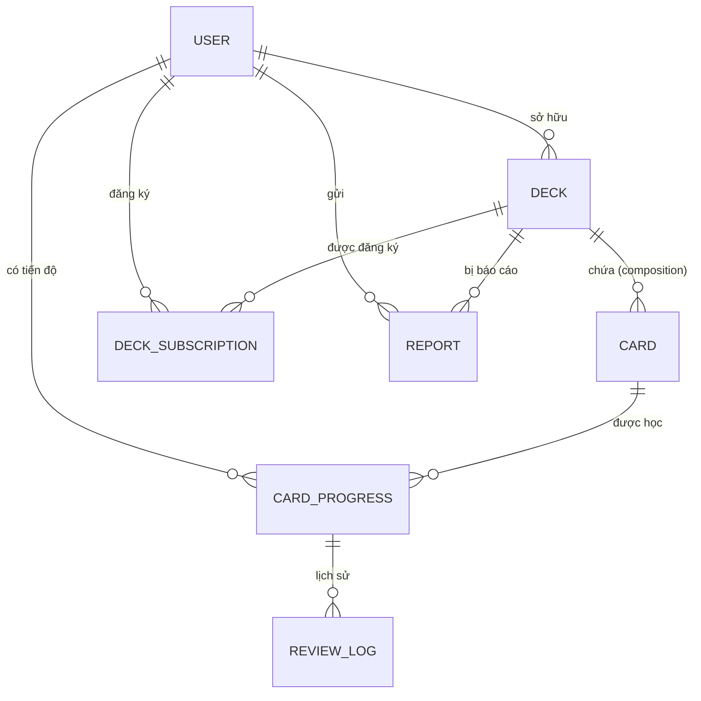

# Đặc tả nghiệp vụ — SpacedVocab

> **Nguồn sự thật (source of truth)** cho nghiệp vụ. Code, API và thiết kế UI phải bám theo file này.
> Thay đổi nghiệp vụ → sửa file này trước, rồi mới sửa code.

## 1. Mục tiêu sản phẩm

Người học tạo hoặc đăng ký các **bộ thẻ từ vựng (deck)**. Mỗi ngày hệ thống chỉ đưa ra **những thẻ đến hạn**. Người học tự chấm mức độ nhớ, thuật toán **SM-2** tính **ngày ôn tiếp theo**: nhớ càng chắc thì càng lâu mới gặp lại.

## 2. Tác nhân (Actors)

| Mã | Tác nhân | Loại | Mô tả |
|---|---|---|---|
| GUEST | Khách | Người | Chưa đăng nhập |
| LEARNER | Người học | Người | Tác nhân chính, role `LEARNER` |
| ADMIN | Quản trị viên | Người | Role `ADMIN` |
| SYSTEM | Hệ thống | Hệ thống | Thuật toán SM-2 và các job theo lịch |

### 2.1 Guest
- **UC-G1** Đăng ký tài khoản.
- **UC-G2** Đăng nhập.
- **UC-G3** Xem và tìm kiếm deck `PUBLIC` / `OFFICIAL` (chỉ xem, không học được).

### 2.2 Learner
| Nhóm | Use case |
|---|---|
| Tài khoản | **UC-L1** xem/sửa hồ sơ · **UC-L2** đổi mật khẩu · **UC-L3** cài `dailyNewLimit` (mặc định 20) và `timezone` |
| Deck | **UC-L4** tạo/sửa/xóa deck của mình, chọn `PRIVATE` hoặc `PUBLIC` |
| Card | **UC-L5** thêm/sửa/xóa card · **UC-L6** import nhiều card từ CSV |
| Thư viện | **UC-L7** đăng ký (subscribe) / hủy đăng ký deck `PUBLIC` hoặc `OFFICIAL` (chỉ học, không sửa) |
| Ôn tập | **UC-L8** lấy danh sách thẻ đến hạn · **UC-L9** chấm điểm một thẻ → SM-2 cập nhật lịch ôn |
| Thống kê | **UC-L10** xem số lượt ôn theo ngày, streak, tỷ lệ nhớ, phân bố trạng thái thẻ |
| Kiểm duyệt | **UC-L11** report một deck công khai vi phạm |

### 2.3 Admin
- **UC-A1** Xem danh sách user, **khóa / mở khóa** tài khoản.
- **UC-A2** Tạo, sửa, xóa deck `OFFICIAL` (ví dụ Oxford 3000, IELTS).
- **UC-A3** Xử lý report: **ẩn deck** hoặc **bỏ qua** report.
- **UC-A4** Xem thống kê toàn hệ thống.

### 2.4 System
- **UC-S1** Chạy SM-2 mỗi khi Learner chấm điểm.
- **UC-S2** Job hằng đêm: chốt streak theo timezone của từng người, tổng hợp thống kê.
- **UC-S3** *(Giai đoạn sau)* Gửi email nhắc ôn.

## 3. Thực thể và mối liên hệ



| Thực thể | Vai trò | Thuộc tính chính |
|---|---|---|
| **User** | Tài khoản | `email` (unique), `passwordHash`, `displayName`, `role` LEARNER/ADMIN, `status` ACTIVE/LOCKED, `dailyNewLimit`, `timezone` |
| **Deck** | Bộ thẻ | `owner`, `name`, `description`, `visibility` PRIVATE/PUBLIC/OFFICIAL, `hidden`, `deleted` |
| **Card** | **Nội dung** thẻ (dùng chung) | `word`, `meaning`, `ipa`, `partOfSpeech`, `example`, `note` |
| **CardProgress** | **Tiến độ riêng** của 1 user với 1 card | `easinessFactor`, `repetitions`, `intervalDays`, `nextReviewAt`, `state` NEW/LEARNING/REVIEW, `lapses` — unique (`user`, `card`) |
| **ReviewLog** | Nhật ký mỗi lần ôn (bất biến) | `quality`, `reviewedAt`, EF trước/sau, interval trước/sau |
| **DeckSubscription** | User đăng ký học deck | `user`, `deck`, `subscribedAt` |
| **Report** | Báo cáo vi phạm | `reporter`, `deck`, `reason`, `status` OPEN/RESOLVED/DISMISSED |

**Quyết định thiết kế:** tách **Card** (nội dung) khỏi **CardProgress** (tiến độ của từng người) để nhiều người học chung 1 deck mà không phải copy thẻ.

## 4. Ràng buộc nghiệp vụ

| Mã | Quy tắc |
|---|---|
| **R1** | Email không trùng (không phân biệt hoa thường). Mật khẩu 8–72 ký tự. Tài khoản `LOCKED` không đăng nhập, không refresh được, và token đang có bị chặn ngay. Đổi mật khẩu → đăng xuất mọi phiên khác. |
| **R2** | Tên deck không trùng trong cùng một chủ sở hữu. `word` không trùng trong cùng một deck (không phân biệt hoa thường). |
| **R3** | Chỉ chủ sở hữu được sửa deck/card. Deck `OFFICIAL` chỉ Admin tạo và sửa. |
| **R4** | Chỉ subscribe được deck `PUBLIC`/`OFFICIAL` và không phải của chính mình. |
| **R5** | `quality` ∈ [0..5], `EF ≥ 1.3`, `interval ≥ 1` ngày. |
| **R6** | Chỉ chấm điểm thẻ thuộc deck mình sở hữu hoặc đã subscribe. |
| **R7** | Số thẻ **mới** mỗi ngày ≤ `dailyNewLimit`. "Ngày" tính theo timezone của người học. |
| **R8** | Deck đang có người subscribe thì chỉ **xóa mềm**. Không bao giờ xóa `ReviewLog`. |
| **R9** | Streak +1 khi trong ngày có ≥ 1 lượt ôn. Bỏ một ngày thì streak về 0. |

## 5. Thuật toán SM-2

Nguồn: Piotr Woźniak (1987), SuperMemo. Giá trị khởi tạo: `EF = 2.5`, `repetitions = 0`, `interval = 0`.

```
Đầu vào: quality q ∈ [0..5]
Nếu q < 3 (quên):  repetitions = 0, interval = 1        (EF giữ nguyên — theo bản gốc)
Nếu q ≥ 3 (nhớ):
    repetitions == 0 → interval = 1
    repetitions == 1 → interval = 6
    còn lại          → interval = round(interval × EF)
    repetitions += 1
    EF = max(1.3, EF + (0.1 − (5−q) × (0.08 + (5−q) × 0.02)))
nextReviewAt = hôm nay (timezone người học) + interval ngày
```

### Ánh xạ nút trên giao diện → `quality`

| Nút | `quality` | Ý nghĩa |
|---|---|---|
| Quên | 1 | Không nhớ ra |
| Khó | 3 | Nhớ nhưng rất vất vả |
| Nhớ | 4 | Nhớ sau một chút suy nghĩ |
| Dễ | 5 | Nhớ ngay lập tức |

API vẫn nhận đủ 0–5; giao diện chỉ dùng 4 mức cho đơn giản.

### Trạng thái thẻ (`state`)
- `NEW`: chưa ôn lần nào.
- `LEARNING`: `repetitions < 2` (đang trong 2 bước đầu 1 → 6 ngày, hoặc vừa quên).
- `REVIEW`: `repetitions ≥ 2`.
